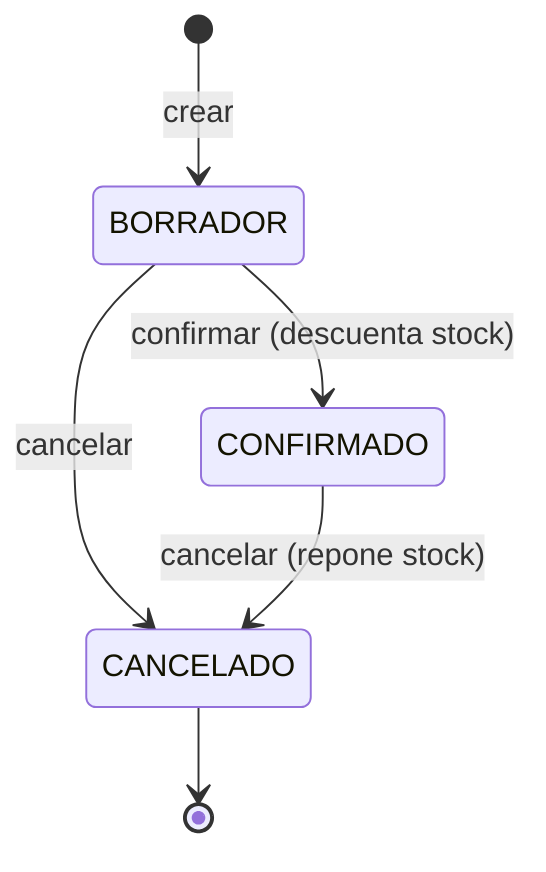

# 02. Requerimientos

Levantamiento de requerimientos a partir del enunciado del examen técnico. Todo lo que el enunciado no define queda en la sección de **supuestos** (sección 6) para confirmarlo o ajustarlo.

## 1. Alcance

**Dentro del alcance:** catálogo de productos, inventario, creación de pedidos con una o más partidas, ciclo de vida del pedido (confirmar y cancelar), consulta con filtros, trazabilidad mínima, manejo de errores de negocio, API REST documentada, frontend Angular y base de datos relacional.

**Fuera del alcance:** autenticación y roles, pagos, impuestos y descuentos, integración con servicios externos, multi-sucursal, historial de movimientos de inventario (kardex), despliegue en nube.

## 2. Actores

| Actor | Descripción |
|---|---|
| Operador de la tienda | Único actor. Consulta el catálogo, administra productos, crea y gestiona pedidos. No hay autenticación |

## 3. Casos de uso

| ID | Caso de uso | Resumen |
|---|---|---|
| CU-01 | Consultar catálogo | Ver productos con precio y existencia |
| CU-02 | Gestionar producto | Crear o actualizar un producto |
| CU-03 | Crear pedido | Elegir productos y cantidades; se genera un `BORRADOR` |
| CU-04 | Consultar pedidos | Listado con folio, fecha, estado y total; filtro por estado o folio |
| CU-05 | Consultar detalle de pedido | Ver las partidas de un pedido |
| CU-06 | Confirmar pedido | Validar stock y descontar inventario de forma atómica |
| CU-07 | Cancelar pedido | Cancelar; si estaba confirmado, repone stock una sola vez |

### 3.1 Especificación de los casos críticos

**CU-03 Crear pedido**

| Campo | Detalle |
|---|---|
| Precondición | Existen productos activos en el catálogo |
| Flujo principal | 1. El operador agrega una o más partidas (producto y cantidad). 2. El frontend muestra un resumen preliminar. 3. El operador envía el pedido. 4. El backend valida productos y cantidades, toma el precio vigente de cada producto, calcula subtotales y total, genera el folio y guarda el pedido en estado `BORRADOR`. 5. Responde 201 con el pedido y sus importes |
| Flujos alternos | Lista de partidas vacía: 400. Cantidad menor o igual a 0: 400. Producto inexistente o inactivo: 404. Producto repetido en la lista: se rechaza con 400 (una partida por producto) |
| Postcondición | Pedido en `BORRADOR`. **El inventario no cambia** |

**CU-06 Confirmar pedido**

| Campo | Detalle |
|---|---|
| Precondición | El pedido existe y está en `BORRADOR` |
| Flujo principal | 1. El operador pulsa Confirmar. 2. En una sola transacción, el backend bloquea los productos del pedido (orden por `id`), verifica que la existencia alcance para cada partida, descuenta las cantidades y cambia el estado a `CONFIRMADO` con `fecha_actualizacion`. 3. Responde 200 |
| Flujos alternos | Pedido inexistente: 404. Estado distinto de `BORRADOR`: 409. Stock insuficiente en una o más partidas: 422, **rollback total**, ningún producto se modifica y el pedido sigue en `BORRADOR` |
| Postcondición | Estado `CONFIRMADO`; existencia disminuida exactamente en la cantidad de cada partida |

**CU-07 Cancelar pedido**

| Campo | Detalle |
|---|---|
| Precondición | El pedido existe y está en `BORRADOR` o `CONFIRMADO` |
| Flujo principal | 1. El operador pulsa Cancelar. 2. En una transacción, el backend lee el estado con bloqueo. Si era `CONFIRMADO`, repone la existencia de cada partida. Registra `fecha_cancelacion` y `fecha_actualizacion` y cambia el estado a `CANCELADO`. 3. Responde 200 |
| Flujos alternos | Pedido inexistente: 404. Ya está `CANCELADO`: 409, sin tocar el inventario (cancelación idempotente) |
| Postcondición | Estado `CANCELADO`. La existencia se repuso exactamente una vez si el pedido estaba confirmado; si era borrador, no hubo nada que reponer |

### 3.2 Ciclo de vida del pedido

| Estado actual | Confirmar | Cancelar |
|---|---|---|
| BORRADOR | Permitido → CONFIRMADO | Permitido → CANCELADO |
| CONFIRMADO | Rechazado (409) | Permitido → CANCELADO |
| CANCELADO | Rechazado (409) | Rechazado (409) |

## 4. Requerimientos funcionales

Prioridad: **M** = obligatorio según el enunciado, **D** = deseable.

| ID | Requerimiento | CU | Prior. |
|---|---|---|---|
| RF-01 | Cada producto tiene identificador, nombre, descripción opcional, precio unitario (mayor a 0) y existencia (no negativa) | CU-01, CU-02 | M |
| RF-02 | Crear y actualizar productos, y cargar un catálogo inicial mediante script SQL | CU-02 | M |
| RF-03 | Listar productos y consultar un producto por id | CU-01 | M |
| RF-04 | Crear un pedido con una o más partidas (producto y cantidad entera mayor a 0) | CU-03 | M |
| RF-05 | El backend calcula subtotal por partida y total del pedido; los importes enviados por el cliente se ignoran | CU-03 | M |
| RF-06 | La partida conserva el precio unitario vigente al momento de crear el pedido | CU-03 | M |
| RF-07 | Confirmar un pedido valida existencia suficiente en todas sus partidas; si falta una, se rechaza completo | CU-06 | M |
| RF-08 | Confirmar descuenta el inventario y cambia el estado en una operación atómica | CU-06 | M |
| RF-09 | Cancelar un pedido confirmado repone la existencia exactamente una vez | CU-07 | M |
| RF-10 | Solo se permiten las transiciones de la tabla 3.2; las demás se rechazan con respuesta controlada | CU-06, CU-07 | M |
| RF-11 | Listar pedidos con folio, fecha, estado y total, con filtro por estado y por folio | CU-04 | M |
| RF-12 | Consultar el detalle de un pedido con sus partidas | CU-05 | M |
| RF-13 | Registrar fecha de creación, y cuando aplique, fecha de actualización y de cancelación | CU-03, CU-06, CU-07 | M |
| RF-14 | El folio del pedido es único y se genera automáticamente (formato `PED-000001`) | CU-03 | M |
| RF-15 | Errores de negocio claros: producto inexistente, cantidad inválida, stock insuficiente, pedido no encontrado, transición no permitida | Todos | M |
| RF-16 | Frontend: catálogo, formulario de pedido, resumen de importes, consulta de pedidos y botones Confirmar/Cancelar según el estado | CU-01 a CU-07 | M |
| RF-17 | Validaciones en frontend y backend; las del frontend no sustituyen a las del servidor | Todos | M |
| RF-18 | Documentación de la API con Swagger/OpenAPI | Todos | M |
| RF-19 | Baja lógica de productos (campo `activo`) para no romper pedidos históricos | CU-02 | D |
| RF-20 | Filtro del listado de pedidos por rango de fechas | CU-04 | D |

### 4.1 Errores de negocio y códigos HTTP

| Situación | HTTP | Código de error (propuesto) |
|---|---|---|
| Datos inválidos (cantidad menor o igual a 0, precio menor o igual a 0, lista vacía, producto repetido) | 400 | `VALIDACION` |
| Producto o pedido inexistente | 404 | `PRODUCTO_NO_ENCONTRADO`, `PEDIDO_NO_ENCONTRADO` |
| Transición de estado no permitida (incluye cancelar dos veces) | 409 | `TRANSICION_NO_PERMITIDA` |
| Stock insuficiente | 422 | `STOCK_INSUFICIENTE` |
| Error no previsto | 500 | `ERROR_INTERNO` (mensaje genérico, sin traza) |

Formato de error JSON propuesto: `{ "codigo": "...", "mensaje": "...", "detalles": [ ... ], "fecha": "..." }`. Sin trazas ni nombres de clases.

## 5. Requerimientos no funcionales

| ID | Categoría | Requerimiento |
|---|---|---|
| RNF-01 | Consistencia | Las operaciones críticas (crear, confirmar, cancelar) son transaccionales (ACID). Un fallo no deja pedidos parciales ni inventario modificado |
| RNF-02 | Concurrencia | Dos confirmaciones simultáneas no pueden descontar más stock del existente. Bloqueo pesimista ordenado por `id` |
| RNF-03 | Integridad de datos | Claves primarias y foráneas, `UNIQUE`, `NOT NULL` y `CHECK` en la base de datos, además de las validaciones de la aplicación |
| RNF-04 | Persistencia | Base de datos relacional real; los datos sobreviven al reinicio de la aplicación |
| RNF-05 | Normalización | Modelo de datos en 3FN (ver documento 03) |
| RNF-06 | Seguridad | Sin credenciales en el repositorio; configuración por variables de entorno; sin trazas ni datos sensibles en respuestas ni en la interfaz |
| RNF-07 | Usabilidad | Mensajes de error comprensibles; los botones Confirmar/Cancelar solo aparecen cuando la acción es válida |
| RNF-08 | Mantenibilidad | Arquitectura en capas (controller, service, repository), código legible, DTOs separados de las entidades |
| RNF-09 | Reproducibilidad | Compilar y ejecutar siguiendo solo el README; scripts SQL que corren tal cual en el orden documentado |
| RNF-10 | Documentación | README completo, API documentada y decisiones técnicas explicadas |
| RNF-11 | Rendimiento | Sin metas estrictas; el listado de pedidos usa índices y no debe cargar partidas innecesarias (objetivo razonable: respuestas por debajo de 1 s con el volumen de datos de ejemplo) |
| RNF-12 | Portabilidad | Funciona en Windows (WSL2) y Linux; Oracle en contenedor |
| RNF-13 | Testabilidad | Pruebas automáticas de los escenarios críticos (stock insuficiente, doble cancelación, transición inválida) |

## 6. Restricciones y supuestos

### 6.1 Restricciones

| Tipo | Restricción |
|---|---|
| Tecnológica | Java 17, Spring Boot 4, Maven; Angular 19; REST con JSON |
| Base de datos | Oracle o MySQL (el enunciado). Se elige Oracle. H2 solo para desarrollo |
| Control de versiones | Git, historial razonable, sin secretos |
| Entrega | 3 días naturales desde la recepción del enunciado; el despliegue se hace solo con el README y los scripts se ejecutan tal cual |
| Alcance | Sin autenticación, pagos ni servicios externos |

### 6.2 Supuestos (por confirmar)

| # | Supuesto | Efecto si cambia |
|---|---|---|
| S-01 | El inventario se descuenta al **confirmar**, no al crear el borrador | Cambia el flujo de CU-03 y la cancelación de borradores |
| S-02 | Un pedido tiene como máximo una partida por producto | Se quita la restricción `UNIQUE (pedido_id, producto_id)` |
| S-03 | Las cantidades son enteros positivos | Cambia el tipo de `cantidad` |
| S-04 | Moneda única (MXN), sin impuestos ni descuentos; total = suma de subtotales | Hay que agregar columnas de impuestos |
| S-05 | Un pedido `BORRADOR` no se edita; se cancela y se crea otro | Habría que añadir CU de edición y su endpoint |
| S-06 | Los productos no se borran físicamente; se desactivan | Cambia RF-19 |
| S-07 | El nombre de producto es único | Se quita `UNIQUE` en `nombre` |
| S-08 | `subtotal` de partida y `total` de pedido no se almacenan, se derivan (por 3FN) | Ver decisión en el documento 03 |
| S-09 | El stock se guarda como saldo actual en `producto`, sin tabla de movimientos | Un kardex sería una mejora futura |

## 7. Escenarios de aceptación

Los datos de prueba corresponden al script `02_data.sql` (documento 04).

| ID | Escenario | Pasos | Resultado esperado |
|---|---|---|---|
| A | Pedido con dos o más productos | Crear pedido con Leche x2 y Pan x1 | Subtotales 49.00 y 38.90; total 87.90 calculado por el backend; estado `BORRADOR`; inventario sin cambios |
| B | Stock insuficiente | Crear un pedido con Atún x10 (existencia 5) y confirmarlo | 422 `STOCK_INSUFICIENTE`; existencia de Atún sigue en 5; ningún producto modificado; el pedido no queda como confirmado |
| C | Confirmar pedido válido | Confirmar el pedido creado en A | Estado `CONFIRMADO`; Leche 118 y Pan 59 (partiendo de 120 y 60) |
| D | Cancelar pedido confirmado | Cancelar el pedido de C y repetir la cancelación | Primera vez: `CANCELADO` y existencias repuestas a 120 y 60. Segunda vez: 409 y existencias sin cambio |
| E | Transición no permitida | Confirmar un pedido `CANCELADO` (por ejemplo `PED-000003`) | 409 `TRANSICION_NO_PERMITIDA` con mensaje claro |
| F | Persistencia | Detener y volver a iniciar backend y base de datos | Pedidos, estados e inventario permanecen |

## 8. Trazabilidad con el enunciado

| Regla del enunciado | Requerimientos |
|---|---|
| 1. Catálogo de productos | RF-01, RF-02, RF-03 |
| 2. Creación de pedido | RF-04, RF-05, RF-06 |
| 3. Validación de inventario | RF-07, RF-08, RNF-01, RNF-02 |
| 4. Ciclo de vida | RF-10 |
| 5. Cancelación | RF-09 |
| 6. Consulta y seguimiento | RF-11, RF-12, RF-20 |
| 7. Trazabilidad mínima | RF-13, RF-14 |
| 8. Errores de negocio | RF-15 |
