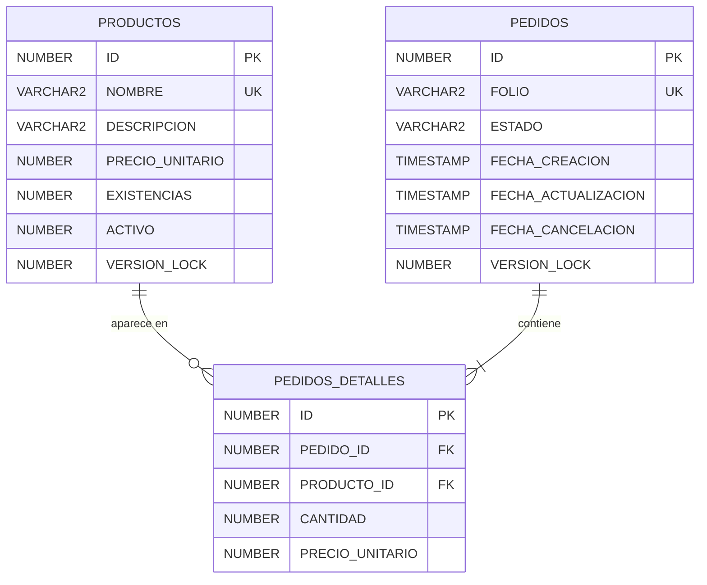

# 03. Entidades, tablas y normalización

Modelo de datos del proyecto: cómo se llegó a las tablas (normalización hasta 3FN), el diccionario de datos con los nombres reales de Oracle y la relación con las entidades JPA.

## 1. Normalización

### 1.1 Punto de partida (0FN)

Una "hoja de pedido" mezcla datos del pedido, de los productos y de cada partida:

```
PEDIDO_0FN ( folio, fecha_creacion, estado, total,
             { producto_id, nombre, descripcion, precio, existencia, cantidad, subtotal } )
               ^ grupo repetido: uno por cada producto del pedido
```

### 1.2 Primera forma normal (1FN)

**Regla:** valores atómicos, sin grupos repetidos y con clave primaria.

El grupo repetido se convierte en una fila por cada pareja pedido-producto, con clave `(folio, producto_id)`:

```
PEDIDO_PARTIDA_1FN ( folio, producto_id, fecha_creacion, estado, total,
                     nombre, descripcion, precio, existencia, cantidad, subtotal )
```

Problemas que quedan:

| Anomalía | Ejemplo |
|---|---|
| Inserción | No se puede registrar un producto sin un pedido que lo incluya |
| Actualización | Cambiar el nombre de un producto obliga a cambiar todas sus filas |
| Eliminación | Borrar el único pedido de un producto borra también el producto |

### 1.3 Segunda forma normal (2FN)

**Regla:** 1FN y ningún atributo no clave depende solo de una parte de la clave.

| Determinante | Determina | Dependencia |
|---|---|---|
| `folio` | `fecha_creacion`, `estado`, `total` | Parcial |
| `producto_id` | `nombre`, `descripcion`, `precio`, `existencia` | Parcial |
| `(folio, producto_id)` | `cantidad`, precio al momento del pedido, `subtotal` | Completa |

Cada grupo pasa a su propia tabla:

```
PEDIDO         ( folio, fecha_creacion, estado, total )
PRODUCTO       ( producto_id, nombre, descripcion, precio, existencia )
PEDIDO_DETALLE ( folio, producto_id, cantidad, precio_unitario, subtotal )
```

### 1.4 Tercera forma normal (3FN)

**Regla:** 2FN y ningún atributo no clave depende de otro atributo no clave.

| Tabla | Dependencia transitiva | Decisión |
|---|---|---|
| `PEDIDO_DETALLE` | `subtotal = cantidad × precio_unitario` | **No se guarda.** El backend lo calcula en `PedidoDetalle.getSubtotal()` |
| `PEDIDO` | `total = suma de los subtotales` (depende de otra tabla) | **No se guarda.** El backend lo calcula en `Pedido.calcularTotal()` |
| `PEDIDO` | Una `descripcion_estado` dependería de `estado` | No se agrega; `estado` es un código con dominio fijo (`CHECK`) |
| `PRODUCTO` | Ninguna | Cumple |

Guardar subtotal o total sería redundante: si alguien cambiara la cantidad o el precio sin recalcularlos, la base de datos quedaría con importes que no cuadran. Además el enunciado pide que los importes los calcule el backend.

**`precio_unitario` en el detalle no es redundante.** `PRODUCTOS.PRECIO_UNITARIO` es el precio actual del catálogo; `PEDIDOS_DETALLES.PRECIO_UNITARIO` es el precio con el que se hizo el pedido. Sin él, cambiar el precio del catálogo cambiaría el importe de pedidos ya registrados.

**`existencia`** se guarda como saldo actual del producto (depende solo de su clave). Calcularla desde un historial de movimientos está fuera del alcance.

### 1.5 Comprobación (BCNF)

| Tabla | Claves candidatas | ¿Todo determinante es clave candidata? |
|---|---|---|
| `PRODUCTOS` | `ID`, `NOMBRE` | Sí |
| `PEDIDOS` | `ID`, `FOLIO` | Sí |
| `PEDIDOS_DETALLES` | `ID`, `(PEDIDO_ID, PRODUCTO_ID)` | Sí |

## 2. Modelo entidad-relación



| Relación | Cardinalidad | Regla |
|---|---|---|
| `PEDIDOS` → `PEDIDOS_DETALLES` | 1 a N (mínimo 1) | Un pedido tiene una o más partidas; la API no permite crear pedidos vacíos |
| `PRODUCTOS` → `PEDIDOS_DETALLES` | 1 a N (mínimo 0) | Un producto puede estar en muchas partidas o en ninguna |
| `PEDIDOS_DETALLES` | `UNIQUE (PEDIDO_ID, PRODUCTO_ID)` | Un producto aparece una sola vez por pedido |

## 3. Diccionario de datos

Script: `database/oracle/01_schema.sql`. Usuario dueño: `OSIN`.

Oracle guarda una cadena vacía (`''`) como `NULL`; por eso una descripción vacía se guarda como `NULL`.

### 3.1 `PRODUCTOS`

| Columna | Tipo | Nulo | Por defecto | Restricción | Descripción |
|---|---|---|---|---|---|
| `ID` | `NUMBER(19)` | No | `IDENTITY` | `PK_PRODUCTOS` | Identificador |
| `NOMBRE` | `VARCHAR2(120 CHAR)` | No | | `UQ_PRODUCTOS_NOMBRE` | Nombre único |
| `DESCRIPCION` | `VARCHAR2(500 CHAR)` | Sí | | | Descripción opcional |
| `PRECIO_UNITARIO` | `NUMBER(12,2)` | No | | `CK_PRODUCTOS_PRECIO` (`> 0`) | Precio actual |
| `EXISTENCIAS` | `NUMBER(10)` | No | `0` | `CK_PRODUCTOS_EXISTENCIAS` (`>= 0`) | Piezas disponibles |
| `ACTIVO` | `NUMBER(1)` | No | `1` | `CK_PRODUCTOS_ACTIVO` (`0` o `1`) | Baja lógica |
| `VERSION_LOCK` | `NUMBER(19)` | No | `0` | | Versión para el bloqueo optimista (`@Version`) |

### 3.2 `PEDIDOS`

| Columna | Tipo | Nulo | Por defecto | Restricción | Descripción |
|---|---|---|---|---|---|
| `ID` | `NUMBER(19)` | No | `IDENTITY` | `PK_PEDIDOS` | Identificador interno |
| `FOLIO` | `VARCHAR2(30 CHAR)` | No | | `UQ_PEDIDOS_FOLIO` | Folio visible `PED-000001`, generado con `SEQ_PEDIDOS_FOLIO` |
| `ESTADO` | `VARCHAR2(20 CHAR)` | No | `'BORRADOR'` | `CK_PEDIDOS_ESTADO` | `BORRADOR`, `CONFIRMADO`, `COMPLETADO` o `CANCELADO` |
| `FECHA_CREACION` | `TIMESTAMP` | No | `SYSTIMESTAMP` | | Momento de creación |
| `FECHA_ACTUALIZACION` | `TIMESTAMP` | No | `SYSTIMESTAMP` | | Se actualiza en cada cambio de estado |
| `FECHA_CANCELACION` | `TIMESTAMP` | Sí | | `CK_PEDIDOS_CANCELACION` | Obligatoria si el estado es `CANCELADO` y nula en cualquier otro |
| `VERSION_LOCK` | `NUMBER(19)` | No | `0` | | Versión para el bloqueo optimista (`@Version`) |

### 3.3 `PEDIDOS_DETALLES`

| Columna | Tipo | Nulo | Restricción | Descripción |
|---|---|---|---|---|
| `ID` | `NUMBER(19)` | No | `PK_PEDIDOS_DETALLES` | Identificador de la partida |
| `PEDIDO_ID` | `NUMBER(19)` | No | `FK_PEDIDOS_DETALLES_PEDIDO` → `PEDIDOS(ID)` | Pedido |
| `PRODUCTO_ID` | `NUMBER(19)` | No | `FK_PEDIDOS_DETALLES_PRODUCTO` → `PRODUCTOS(ID)` | Producto |
| `CANTIDAD` | `NUMBER(10)` | No | `CK_PEDIDOS_DETALLES_CANTIDAD` (`> 0`) | Piezas solicitadas |
| `PRECIO_UNITARIO` | `NUMBER(12,2)` | No | `CK_PEDIDOS_DETALLES_PRECIO` (`> 0`) | Precio al crear el pedido |

`UQ_PEDIDOS_DETALLES_PEDIDO_PRODUCTO` sobre `(PEDIDO_ID, PRODUCTO_ID)`.

### 3.4 Otros objetos

| Objeto | Tipo | Propósito |
|---|---|---|
| `SEQ_PEDIDOS_FOLIO` | Secuencia (`START WITH 4`) | Número del folio. Empieza en 4 porque `02_data.sql` inserta `PED-000001` a `PED-000003` |
| `IX_PEDIDOS_ESTADO` | Índice | Filtro del listado por estado |
| `IX_PEDIDOS_DETALLES_PRODUCTO` | Índice | Búsquedas por producto y validación de la FK |
| `VW_PEDIDO_RESUMEN` | Vista | Folio, estado, total y número de partidas, para revisar los datos desde SQL Developer. La API no la usa |

Los `UNIQUE` de `FOLIO` y de `(PEDIDO_ID, PRODUCTO_ID)` crean su propio índice.

## 4. Reglas de integridad

| Regla | Base de datos | Backend |
|---|---|---|
| Precio mayor a 0, existencia no negativa, cantidad mayor a 0 | `CHECK` | Bean Validation en DTO y validación en entidades |
| Folio único | `UNIQUE` + secuencia | `Pedido.formatearFolio` |
| Estados válidos | `CHECK` | Enum `EstadoPedido` |
| Transiciones válidas | | `EstadoPedido.puedeCambiar()` |
| Sin partidas huérfanas | FK sin `ON DELETE CASCADE`; los pedidos no se borran, se cancelan | |
| Un producto por pedido | `UNIQUE (PEDIDO_ID, PRODUCTO_ID)` | Validación en `PedidoServiceImpl` (400) |
| Inventario nunca negativo | `CHECK (EXISTENCIAS >= 0)` como última defensa | `Producto.validarExistenciasSuficientes` |
| Fecha de cancelación coherente | `CK_PEDIDOS_CANCELACION` | `Pedido.cancelar` |

## 5. Correspondencia con JPA

| Tabla | Entidad | Notas |
|---|---|---|
| `PRODUCTOS` | `Producto` | `@Version` sobre `VERSION_LOCK`; `ACTIVO` con `BooleanToNumberConverter`; `EXISTENCIAS` en el campo `existencias` |
| `PEDIDOS` | `Pedido` | `@Version` sobre `VERSION_LOCK`; `ESTADO` con `@Enumerated(EnumType.STRING)`; `@OneToMany` a `PedidoDetalle` |
| `PEDIDOS_DETALLES` | `PedidoDetalle` | `@ManyToOne` a `Pedido` y `Producto`; `getSubtotal()` calcula `cantidad × precioUnitario` |

Todos los `@Id` usan `GenerationType.IDENTITY` (columnas `GENERATED BY DEFAULT AS IDENTITY`).
