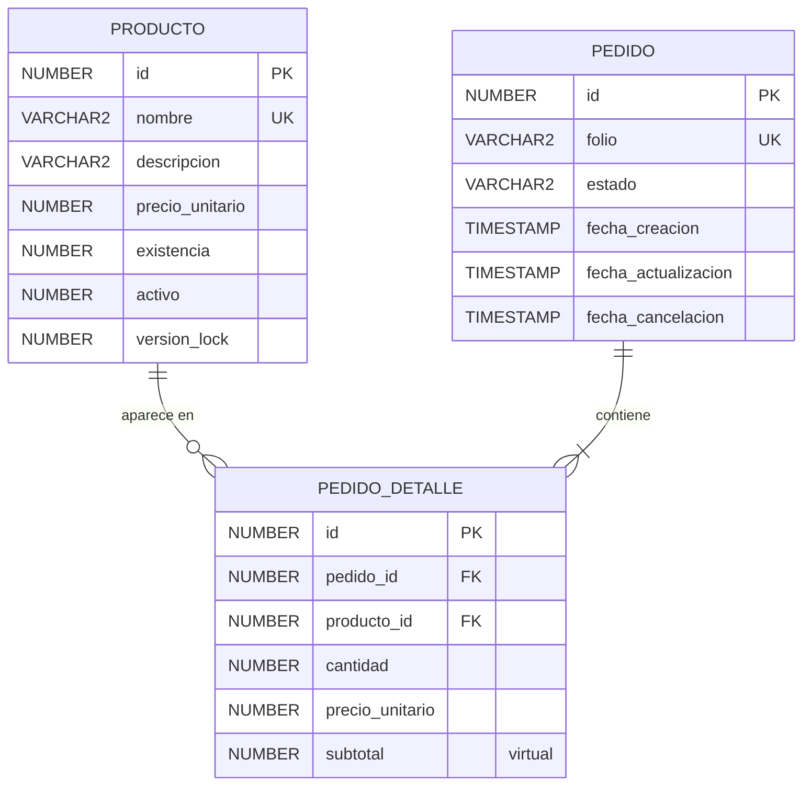

# 03. Entidades, tablas y normalización

Este documento define el modelo de datos **antes** de escribir los scripts de Oracle. Primero se parte de la información tal como aparece en un pedido y se normaliza paso a paso hasta la **tercera forma normal (3FN)**; después se presentan las tablas finales con sus tipos y restricciones.

## 1. Normalización

### 1.1 Punto de partida: datos sin normalizar (0FN)

Una "hoja de pedido" contiene, en un solo bloque, datos del pedido, del producto y de cada partida:

```
PEDIDO_0FN ( folio, fecha_creacion, estado, total,
             { producto_id, nombre, descripcion, precio, existencia, cantidad, subtotal } )
                ^ grupo repetido: uno por cada producto del pedido
```

Problemas: grupo repetido, datos del producto copiados en cada pedido y totales que dependen de otros datos.

### 1.2 Primera forma normal (1FN)

**Regla:** todos los atributos son atómicos, no hay grupos repetidos y la tabla tiene una clave primaria.

**Aplicación:**
- El grupo repetido se convierte en filas: una fila por cada combinación pedido-producto.
- Cada columna guarda un solo valor: `folio` es un código completo (`PED-000001`), `fecha_creacion` es una sola fecha y hora, `descripcion` es un texto único.
- Clave primaria compuesta: `(folio, producto_id)`.

```
PEDIDO_PARTIDA_1FN ( folio, producto_id,
                     fecha_creacion, estado, total,
                     nombre, descripcion, precio, existencia,
                     cantidad, subtotal )
PK: (folio, producto_id)
```

Aún quedan anomalías:

| Anomalía | Ejemplo |
|---|---|
| Inserción | No se puede registrar un producto nuevo hasta que exista un pedido que lo incluya |
| Actualización | Cambiar el nombre de un producto obliga a modificar todas las filas de todos sus pedidos |
| Eliminación | Eliminar el único pedido de un producto borra también la información del producto |

### 1.3 Segunda forma normal (2FN)

**Regla:** estar en 1FN y que **ningún atributo que no es clave dependa solo de una parte de la clave compuesta** (sin dependencias parciales).

**Dependencias funcionales detectadas:**

| Determinante | Determina | Tipo respecto a `(folio, producto_id)` |
|---|---|---|
| `folio` | `fecha_creacion`, `estado`, `total` | Parcial (solo depende de una parte de la clave) |
| `producto_id` | `nombre`, `descripcion`, `precio`, `existencia` | Parcial |
| `(folio, producto_id)` | `cantidad`, `precio` pactado, `subtotal` | Completa |

**Aplicación:** cada grupo de atributos pasa a su propia relación.

```
PEDIDO         ( folio PK, fecha_creacion, estado, total )
PRODUCTO       ( producto_id PK, nombre, descripcion, precio, existencia )
PEDIDO_DETALLE ( folio FK, producto_id FK, cantidad, precio_unitario, subtotal )
               PK: (folio, producto_id)
```

Esto elimina las anomalías de 1FN: el producto existe sin pedidos, se renombra en un solo lugar y borrar un pedido no pierde el producto.

### 1.4 Tercera forma normal (3FN)

**Regla:** estar en 2FN y que **ningún atributo que no es clave dependa de otro atributo que tampoco es clave** (sin dependencias transitivas).

**Revisión relación por relación:**

| Relación | Dependencia transitiva detectada | Solución |
|---|---|---|
| `PEDIDO_DETALLE` | `subtotal = cantidad × precio_unitario`. `subtotal` depende de dos atributos no clave | No se almacena como dato: es una **columna virtual** de Oracle calculada a partir de `cantidad` y `precio_unitario` |
| `PEDIDO` | `total = Σ subtotales de sus partidas`. `total` depende de datos de otra tabla, no de la clave del pedido | No se almacena: se obtiene con `SUM` mediante la vista `vw_pedido_resumen` (y el backend lo calcula al responder) |
| `PEDIDO` | Si se guardara una `descripcion_estado`, dependería de `estado` y no de la clave | No se agrega. `estado` es un código atómico con dominio fijo (`CHECK`), sin atributos propios |
| `PRODUCTO` | Ningún atributo no clave determina a otro | Cumple |

**Decisión sobre `precio_unitario` en `PEDIDO_DETALLE`:** no es una dependencia transitiva ni redundancia. Son dos hechos distintos: `PRODUCTO.precio_unitario` es el precio **actual** del catálogo y `PEDIDO_DETALLE.precio_unitario` es el precio **pactado en ese pedido**. Si se eliminara, cambiar el precio del catálogo alteraría el importe de pedidos ya registrados.

**Decisión sobre `existencia`:** se guarda como saldo actual en `PRODUCTO` (depende únicamente de la clave). Derivarla de una tabla de movimientos sería más puro, pero un kardex está fuera del alcance (supuesto S-09).

### 1.5 Verificación final (BCNF como comprobación adicional)

| Tabla | Claves candidatas | ¿Todo determinante es clave candidata? |
|---|---|---|
| `producto` | `id`, `nombre` | Sí |
| `pedido` | `id`, `folio` | Sí |
| `pedido_detalle` | `id`, `(pedido_id, producto_id)` | Sí |

### 1.6 Resumen de cumplimiento

| Forma normal | Cumple | Evidencia |
|---|---|---|
| 1FN | Sí | Sin grupos repetidos; columnas atómicas; toda tabla con clave primaria (`id`) |
| 2FN | Sí | Datos de pedido, producto y partida separados; atributos de partida dependen de la clave completa del detalle |
| 3FN | Sí | `subtotal` y `total` no se almacenan; `estado` sin atributos dependientes; sin dependencias entre atributos no clave |

## 2. Modelo entidad-relación



| Relación | Cardinalidad | Regla |
|---|---|---|
| `pedido` → `pedido_detalle` | 1 a N (mínimo 1 partida) | Un pedido tiene una o más partidas; cada partida pertenece a un solo pedido |
| `producto` → `pedido_detalle` | 1 a N (mínimo 0) | Un producto puede estar en muchas partidas; un producto nuevo puede no estar en ninguna |
| `pedido_detalle` | `UNIQUE (pedido_id, producto_id)` | Un producto aparece una sola vez por pedido |

## 3. Diccionario de datos

Convención: nombres en minúsculas con guion bajo; tipos de Oracle. "Nulo" indica si la columna acepta `NULL`.

Nota sobre Oracle: una cadena vacía (`''`) se almacena como `NULL`. Por eso `descripcion` es opcional y no se guarda vacía.

### 3.1 Tabla `producto`

| Columna | Tipo Oracle | Nulo | Único | Valor por defecto | Restricción | Descripción |
|---|---|---|---|---|---|---|
| `id` | `NUMBER(19)` | No | PK | `IDENTITY` (generado) | `pk_producto` | Identificador del producto |
| `nombre` | `VARCHAR2(120 CHAR)` | No | Sí (`uq_producto_nombre`) | | | Nombre del producto |
| `descripcion` | `VARCHAR2(500 CHAR)` | Sí | No | | | Descripción opcional |
| `precio_unitario` | `NUMBER(12,2)` | No | No | | `CHECK (precio_unitario > 0)` | Precio vigente del catálogo |
| `existencia` | `NUMBER(10)` | No | No | `0` | `CHECK (existencia >= 0)` | Unidades disponibles |
| `activo` | `NUMBER(1)` | No | No | `1` | `CHECK (activo IN (0,1))` | Baja lógica: 1 activo, 0 inactivo |
| `version_lock` | `NUMBER(19)` | No | No | `0` | | Control de concurrencia optimista (`@Version`) |

### 3.2 Tabla `pedido`

| Columna | Tipo Oracle | Nulo | Único | Valor por defecto | Restricción | Descripción |
|---|---|---|---|---|---|---|
| `id` | `NUMBER(19)` | No | PK | `IDENTITY` (generado) | `pk_pedido` | Identificador interno |
| `folio` | `VARCHAR2(30 CHAR)` | No | Sí (`uq_pedido_folio`) | | | Folio visible (`PED-000001`), generado con la secuencia `seq_pedido_folio` |
| `estado` | `VARCHAR2(15 CHAR)` | No | No | `'BORRADOR'` | `CHECK (estado IN ('BORRADOR','CONFIRMADO','CANCELADO'))` | Estado del ciclo de vida |
| `fecha_creacion` | `TIMESTAMP` | No | No | `SYSTIMESTAMP` | | Fecha y hora de creación |
| `fecha_actualizacion` | `TIMESTAMP` | Sí | No | | | Última confirmación o cancelación |
| `fecha_cancelacion` | `TIMESTAMP` | Sí | No | | Ver coherencia abajo | Momento de la cancelación |

Restricción de coherencia (`ck_pedido_cancelacion`): `fecha_cancelacion` es obligatoria si el estado es `CANCELADO` y debe ser nula en cualquier otro estado.

### 3.3 Tabla `pedido_detalle`

| Columna | Tipo Oracle | Nulo | Único | Valor por defecto | Restricción | Descripción |
|---|---|---|---|---|---|---|
| `id` | `NUMBER(19)` | No | PK | `IDENTITY` (generado) | `pk_pedido_detalle` | Identificador de la partida |
| `pedido_id` | `NUMBER(19)` | No | Parte de `uq_detalle_pedido_producto` | | FK → `pedido(id)` | Pedido al que pertenece |
| `producto_id` | `NUMBER(19)` | No | Parte de `uq_detalle_pedido_producto` | | FK → `producto(id)` | Producto solicitado |
| `cantidad` | `NUMBER(10)` | No | No | | `CHECK (cantidad > 0)` | Unidades solicitadas |
| `precio_unitario` | `NUMBER(12,2)` | No | No | | `CHECK (precio_unitario > 0)` | Precio pactado al crear el pedido |
| `subtotal` | `NUMBER(14,2)` | (calculada) | No | `cantidad * precio_unitario` | Columna `VIRTUAL` | No se inserta ni se actualiza; la calcula Oracle |

### 3.4 Objetos adicionales

| Objeto | Tipo | Propósito |
|---|---|---|
| `seq_pedido_folio` | Secuencia (`START WITH 4` por los 3 pedidos de ejemplo) | Genera el número del folio |
| `vw_pedido_resumen` | Vista | Pedido con `total` y número de partidas calculados con `SUM`/`COUNT` |
| `ix_detalle_producto` | Índice sobre `pedido_detalle(producto_id)` | Acelera consultas por producto y la validación de la FK |
| `ix_pedido_estado` | Índice sobre `pedido(estado)` | Filtro del listado por estado |

La unicidad de `pedido(folio)` y de `pedido_detalle(pedido_id, producto_id)` ya genera sus propios índices; `pedido_id` queda cubierto por el índice único compuesto.

## 4. Reglas de integridad

| Regla | Dónde se garantiza |
|---|---|
| Precio mayor a 0, existencia no negativa, cantidad mayor a 0 | `CHECK` en base de datos y validación en backend y frontend |
| Folio único | `UNIQUE (folio)` + secuencia |
| Estados válidos | `CHECK` en base de datos y enum en Java |
| Transiciones válidas | Servicio de pedidos (la base de datos solo valida el dominio y la coherencia de `fecha_cancelacion`) |
| No existen partidas huérfanas | Claves foráneas sin `ON DELETE CASCADE`; los pedidos no se borran, se cancelan |
| Un producto una vez por pedido | `UNIQUE (pedido_id, producto_id)` |
| Inventario nunca negativo | `CHECK (existencia >= 0)` como última defensa, además de la validación y el bloqueo en el servicio |

## 5. Correspondencia con JPA (referencia para la implementación)

| Tabla | Entidad | Notas |
|---|---|---|
| `producto` | `Producto` | `@Version` sobre `version_lock`; `@Id` con `GenerationType.IDENTITY` |
| `pedido` | `Pedido` | `@Enumerated(EnumType.STRING)` para `estado`; relación `@OneToMany` a `PedidoDetalle` |
| `pedido_detalle` | `PedidoDetalle` | `subtotal` no se mapea como columna; se calcula en Java (`cantidad × precioUnitario`) |
